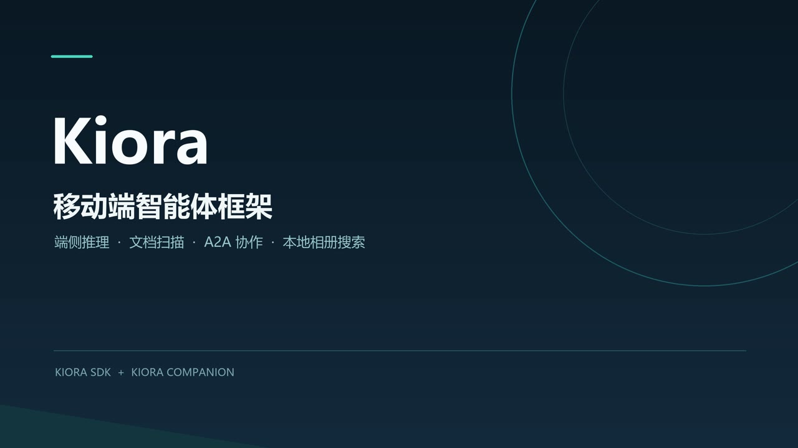
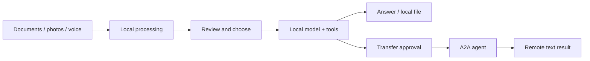

<p align="center"></p>

# Kiora Companion

**An Android agent app for local documents, photos, voice, and A2A collaboration.**

Built with [Kiora SDK](https://github.com/qhvssonic/kiora) · App 0.1.108 · Android 8.0+

**English** | [简体中文](README.zh-CN.md)

[](LICENSE)

[Download APK](https://github.com/qhvssonic/kiora-companion/releases/tag/v0.1.108) · [Demo](#demo) · [What you can do](#what-you-can-do) · [Get started](#get-started) · [Build guide](docs/app-guide.en.md#build-and-run) · [Kiora SDK](https://github.com/qhvssonic/kiora) · [Feedback](https://github.com/qhvssonic/kiora-companion/issues)

Scan a document, find a photo by description, dictate a message, or listen to a reply using local models. When a task needs another agent, connect over A2A and approve what leaves the phone.

Companion is the application; **[Kiora](https://github.com/qhvssonic/kiora) is the reusable Kotlin SDK** behind it. Its A2A peers can run on a server, another device, or a business system. The current integration example uses DSH on a computer.

> Experimental preview: an installable debug-signed APK is available in [Releases](https://github.com/qhvssonic/kiora-companion/releases/tag/v0.1.108). Chat, speech, embedding and face models are imported separately; this APK includes OCR assets. Choosing an online chat model sends ordinary chat input to that provider; use a local model for offline chat.

## Demo

[](https://github.com/qhvssonic/kiora-companion/releases/download/v0.1.108/kiora-demo-zh-subtitles.mp4)

**[▶ Watch / download the demo](https://github.com/qhvssonic/kiora-companion/releases/download/v0.1.108/kiora-demo-zh-subtitles.mp4)** · 3m 28s · Chinese subtitles · 4K MP4, ~203 MiB

Watch local inference, scanning and Markdown organization, A2A file handoff, and semantic photo search. Recorded on **2026-10-22** with an earlier build; current UI and capabilities have changed. The full video is hosted as a Release asset; click the cover or link to open/download it.

## What you can do

| Start with a task | What the app provides | Setup |
| --- | --- | --- |
| **Organize paper documents** | Multi-page scanning, local OCR, page ordering, editable drafts, and model-assisted Markdown/file workflows | OCR assets are included in the preview APK; choose a chat model for model-assisted work |
| **Find a photo by meaning** | Search an indexed local photo library by description; preview and select candidates | EmbeddingGemma 2 text/vision model, photo access, and a local index |
| **Speak instead of type** | Paraformer streaming transcription or SenseVoice after recording; edit text before sending | Import the selected ASR model |
| **Listen to an answer** | Tap the speaker icon for offline MeloTTS read-aloud; tap again to stop | Import a MeloTTS model directory; FP32 is recommended for the tested phone |
| **Find a registered person** | Local enrollment, 1:N matching, front-camera scan queries, and indexed photo lookup | Face models, explicit camera/photo access, enrollment, and indexing |
| **Continue work with another agent** | Discover skills, approve task/file transfer, follow progress, and continue a task that needs input | A phone-reachable A2A 1.x endpoint implementing the required skill |

Local features work after their models and indexes are ready. Remote tasks depend on the peer's actual capabilities. Face workflows are dedicated screens; read-aloud is a manual UI action. Neither is registered as a chat tool by default.



## Get started

### 1. Install the preview APK

Download **`kiora-companion-v0.1.108-debug.apk`** from the [v0.1.108 preview release](https://github.com/qhvssonic/kiora-companion/releases/tag/v0.1.108). The universal APK is approximately **438 MiB** and supports Android 8.0+; model/runtime requirements vary by device. MNN currently packages arm64-v8a only. The release includes bilingual notes, installation details and `SHA256SUMS.txt`.

The APK is debug-signed: an in-place update requires the same signing certificate. Back up data you need before changing installations. To build it yourself, follow the [full build guide](docs/app-guide.en.md#build-and-run) or [中文构建指南](docs/app-guide.zh-CN.md#构建与运行), including the shared ONNX Runtime preparation for OCR and speech. The build output is:

```text
app/build/outputs/apk/debug/app-debug.apk
```

### 2. Choose a chat model

- **Local:** import a supported LiteRT-LM `.litertlm` file or a complete MNN model directory. Weights are copied into app-private storage.
- **Online:** configure a Chat Completions-compatible provider. Online inference requires internet access.

The [ModelScope bundle](https://www.modelscope.cn/models/vqhvqh/kiora_model_bundles) and [model setup guides](https://github.com/qhvssonic/kiora/blob/main/docs/on-device-models.md) explain assets and upstream requirements. Chat, speech, embedding and face model weights are not included in the APK; OCR assets are bundled.

### 3. Try one local workflow

Start with **Scan documents**: add pages, inspect local OCR, reorder or correct the draft, and bring the reviewed text into chat. Add speech, semantic photo search, or face models only when you want those features.

A2A setup is optional. Add an Agent Card URL in settings only when you have a reachable peer; see [connection setup](docs/app-guide.en.md#connecting-to-a-dsh-a2a-service). No remote agent is needed to try local features.

## You choose what leaves the phone

- **Local resource access and external transfer are separate permissions.** Tagged local session data requires confirmation before reaching an online model or A2A recipient, or can be kept local by policy.
- **Source labels survive restarts and derived answers.** This is session-level provenance, not automatic detection of sensitive information in every typed message.
- **Tool calls are visible.** Expand arguments and results; version 0.1.108 distinguishes verified effects, unconfirmed effects, and failed calls.
- **Local media processing stays explicit.** Raw microphone audio is not saved or automatically uploaded. TTS audio and face processing remain local; selected file/photo transfer still requires the configured policy checks.

“Keep local data on device” is **not a global network switch**. Ordinary typed text is handled by the selected model. Use a local chat model for an entirely local conversation.

[Permission details and implementation boundaries](docs/app-guide.en.md#local-data-and-tool-boundaries) · [SDK runtime policy and verification](https://github.com/qhvssonic/kiora/blob/main/docs/runtime-safety.md)

## App or SDK?

| Project | Use it for |
| --- | --- |
| **This repository: Companion** | Android screens, camera/scanning flows, local indexes, permissions, playback, and Room-backed conversations |
| **[Kiora SDK](https://github.com/qhvssonic/kiora)** | Embedding the agent runtime, model adapters, tool interfaces, durable sessions, and A2A in your own application |

## Status and roadmap

**Local validation, 2026-11-03:** 67 Companion JVM tests and the 0.1.108 debug build passed. Earlier V2509A / Android 16 testing covered source/approval flows, voice lifecycle, and 20 mixed-model rounds. Those are scoped observations, not universal device support or a guarantee of model accuracy.

Known limits:

- Gemma 4 E2B knowledge/tool-routing regression still fails. Inspect proposed actions and use suitable models; permission checks do not guarantee correct planning.
- A2A currently consumes remote text results. Returned files, SSE, and push notifications are not implemented; stopping local waiting does not automatically cancel the remote task.
- Streaming ASR is button-triggered microphone input, not always-on listening or system-audio captions. TTS is manual read-aloud, not an automatic voice agent.
- Source setup currently involves native artifact preparation. GPU support, memory use, and supported model formats vary; see the guides rather than assuming all phones behave alike.

Next steps:

- [ ] Improve real-model task/tool reliability and reproduce failures across devices.
- [ ] Expand resource/lifecycle checks for long sessions and alternating local models.
- [ ] Evaluate **Fun-ASR-Nano dialect input** with actual samples. **Planned, not implemented; current ASR is SenseVoice / Paraformer.**

[Device evidence](https://github.com/qhvssonic/kiora/blob/main/docs/runtime-safety.md) · [Fun-ASR plan](https://github.com/qhvssonic/kiora/blob/main/docs/mobile-agent-roadmap.md#fun-asr-plan)

## Guides and feedback

- [English app guide](docs/app-guide.en.md) / [中文应用指南](docs/app-guide.zh-CN.md): models, builds, DSH connections, permissions, faces, and voice setup.
- SDK capability guides: [OCR](https://github.com/qhvssonic/kiora/blob/main/docs/document-ocr.md), [speech recognition](https://github.com/qhvssonic/kiora/blob/main/docs/speech-recognition.md), [speech synthesis](https://github.com/qhvssonic/kiora/blob/main/docs/speech-synthesis.md), [photo embeddings](https://github.com/qhvssonic/kiora/blob/main/docs/embeddinggemma2-integration.md), [face recognition](https://github.com/qhvssonic/kiora/blob/main/docs/face-recognition.md).
- [Report a bug or suggest a workflow](https://github.com/qhvssonic/kiora-companion/issues). Include device/Android version, app version, model/backend, steps, and redacted logs. Do not attach private documents, face data, or credentials.

If Companion helps you explore on-device agents, a star helps others find the project. Contributions to setup docs, translations, and reproducible device reports are welcome.

Source code: [Apache-2.0](LICENSE). Models and native dependencies have separate upstream terms.
