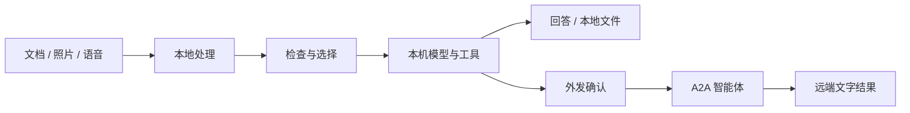

<p align="center"></p>

# Kiora Companion

**在 Android 上用本地模型处理文档、照片和语音，并通过 A2A 与其他智能体协作。**

基于 [Kiora SDK](https://github.com/qhvssonic/kiora) · 应用 0.1.108 · Android 8.0+

[English](README.md) | **简体中文**

[](LICENSE)

[可以做什么](#可以做什么) · [开始体验](#开始体验) · [构建指南](docs/app-guide.zh-CN.md#构建与运行) · [Kiora SDK](https://github.com/qhvssonic/kiora) · [问题反馈](https://github.com/qhvssonic/kiora-companion/issues)

扫描并整理文档，按描述寻找照片，用语音输入消息，或在本机朗读回答。需要其他智能体继续处理时，再通过 A2A 连接，并确认哪些内容可以离开手机。

Companion 是应用，**[Kiora](https://github.com/qhvssonic/kiora) 是可复用的 Kotlin SDK**。A2A 对端可以运行在服务器、其他设备或业务系统中；当前集成示例使用电脑上的 DSH。

> 当前处于实验阶段，通过源码构建体验。模型文件和部分原生依赖需单独准备。选择在线聊天模型时，普通聊天输入会发送给该提供商；离线聊天需选择本机模型。

## 可以做什么

| 从一个任务开始 | 应用提供的流程 | 需要准备 |
| --- | --- | --- |
| **整理纸质文档** | 多页扫描、本地 OCR、页面排序、可编辑草稿及模型辅助 Markdown/文件操作 | OCR 原生构建资产；模型辅助步骤需要聊天模型 |
| **按含义找照片** | 按描述检索已建立本地索引的相册，预览并选择候选照片 | EmbeddingGemma 2 文字/视觉模型、相册授权及索引 |
| **用说话代替打字** | Paraformer 边说边转写，或 SenseVoice 录完识别；确认文字后再发送 | 导入所选 ASR 模型 |
| **听取回复** | 点击扬声器图标用 MeloTTS 离线朗读，再点停止 | 导入 MeloTTS 模型目录；目标测试手机推荐 FP32 |
| **查找已注册人员** | 本地注册、1:N 匹配、前置摄像头扫描查询和相册索引检索 | 人脸模型、摄像头/相册授权、注册及索引 |
| **让其他 Agent 继续处理** | 发现能力、批准任务或文件传输、查看进度，并续接需要补充信息的任务 | 手机可访问、实际实现所需 skill 的 A2A 1.x 对端 |

本地能力在模型和索引准备后使用；远端任务取决于对端真实能力。人脸功能使用独立页面，朗读由用户点击触发，二者默认不注册为聊天工具。



## 开始体验

### 1. 构建并安装

当前体验路径是**源码构建**，需要 JDK 17、Android SDK 35、本机 Maven 中的 SDK 快照，以及已准备的 OCR/语音原生库。应用最低 Android 8.0；模型和运行库仍有各自设备要求。MNN 当前只打包 arm64-v8a。

按[完整构建指南](docs/app-guide.zh-CN.md#构建与运行)准备和构建，其中包含 OCR 与语音共用 ONNX Runtime 的步骤。

```text
app/build/outputs/apk/debug/app-debug.apk
```

### 2. 选择聊天模型

- **本机**：导入支持的 LiteRT-LM `.litertlm` 文件，或完整 MNN 模型目录，权重复制到应用私有存储。
- **在线**：配置兼容 Chat Completions 的提供商，需要联网使用。

[ModelScope 模型合集](https://www.modelscope.cn/models/vqhvqh/kiora_model_bundles)与[模型接入说明](https://github.com/qhvssonic/kiora/blob/main/docs/on-device-models.md)提供资产及上游要求。模型权重不在 APK 中。

### 3. 先试一个本地任务

建议从**扫描文档**开始：添加页面、检查本地 OCR、调整顺序和校对草稿，再将文字带入聊天。需要时再导入语音、相册语义搜索或人脸模型。

A2A 是可选配置。有可访问的对端后，再在设置中添加 Agent Card URL，见[连接设置](docs/app-guide.zh-CN.md#连接-dsh-a2a)。体验本地能力不需要远端 Agent。

## 由你决定什么内容可以外发

- **读取本地资源与向外传输分别授权**：有来源标签的本地会话资料进入在线模型或 A2A 前需确认，也可通过策略限制留在本机。
- **来源标签可继承和持久化**：重启、派生回答和摘要仍保留来源；这是会话级跟踪，不是自动识别每条输入中的敏感信息。
- **工具调用可查看**：展开参数和结果；0.1.108 区分“结果已验证”“效果未确认”和“调用失败”。
- **媒体处理有明确边界**：原始麦克风录音不保存、不自动上传；TTS 音频与人脸处理留在本机；选中文件/照片的外发仍经过配置的策略检查。

“仅在本机处理”**不是全局断网开关**。普通键入文字仍由所选模型处理；完整的本地对话应选择本机聊天模型。

[权限与实现边界](docs/app-guide.zh-CN.md#本地资料与工具边界) · [SDK 运行策略与效果验证](https://github.com/qhvssonic/kiora/blob/main/docs/runtime-safety.md)

## 应用和 SDK 如何分工

| 项目 | 用途 |
| --- | --- |
| **本仓库 Companion** | Android 界面、摄像头/扫描、索引、权限、播放，以及 Room 会话持久化 |
| **[Kiora SDK](https://github.com/qhvssonic/kiora)** | 在自己的应用中接入智能体运行时、模型适配器、工具接口、持久会话和 A2A |

## 当前状态与计划

**2026-11-03 本地验证**：Companion 67 项 JVM 测试和 0.1.108 调试构建通过。此前在 V2509A / Android 16 上覆盖了来源/授权、语音生命周期和 20 轮混合模型循环。这些是限定条件下的记录，不代表所有设备兼容或模型准确率保证。

已知限制：

- Gemma 4 E2B 的知识和工具选择回归仍未通过；需要检查模型提出的动作并选择合适模型，权限校验不能保证规划正确。
- A2A 当前接收远端文字结果；未实现远端文件接收、SSE 和推送。停止本地等待不会自动取消远端任务。
- 实时转写是用户点击麦克风后的输入，不是常开监听或系统音频字幕；TTS 是手动朗读，不是自动语音智能体。
- 源码构建仍需准备原生资产；GPU、内存和支持的模型格式取决于设备与后端，需按指南核对。

下一步：

- [ ] 改进真实模型的任务/工具可靠性，扩大设备复现范围。
- [ ] 补充长会话、多模型交替使用的资源与生命周期验证。
- [ ] 用真实方言样本验证 **Fun-ASR-Nano 方言输入**。**已列入计划，尚未实现；当前使用 SenseVoice / Paraformer。**

[真机与验证记录](https://github.com/qhvssonic/kiora/blob/main/docs/runtime-safety.md) · [Fun-ASR 计划](https://github.com/qhvssonic/kiora/blob/main/docs/mobile-agent-roadmap.md#fun-asr-plan)

## 指南与反馈

- [中文应用指南](docs/app-guide.zh-CN.md) / [English app guide](docs/app-guide.en.md)：模型、构建、DSH 连接、权限、人脸和语音准备。
- SDK 能力说明：[OCR](https://github.com/qhvssonic/kiora/blob/main/docs/document-ocr.md)、[语音识别](https://github.com/qhvssonic/kiora/blob/main/docs/speech-recognition.md)、[语音合成](https://github.com/qhvssonic/kiora/blob/main/docs/speech-synthesis.md)、[图片向量](https://github.com/qhvssonic/kiora/blob/main/docs/embeddinggemma2-integration.md)、[人脸](https://github.com/qhvssonic/kiora/blob/main/docs/face-recognition.md)。
- [提交问题或场景建议](https://github.com/qhvssonic/kiora-companion/issues)：请提供设备/Android 版本、应用版本、模型/后端、复现步骤和脱敏日志，不附私人文档、人脸资料或凭据。

如果 Companion 帮你探索了端侧智能体，欢迎 Star，让更多人发现它。也欢迎改进准备流程、翻译文档和提交可复现的设备记录。

代码采用 [Apache-2.0](LICENSE)，模型和原生依赖遵循各自上游许可。
